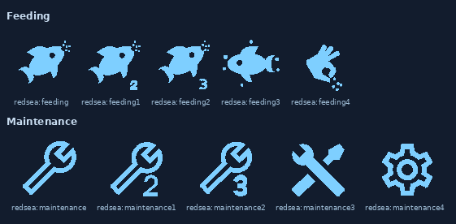
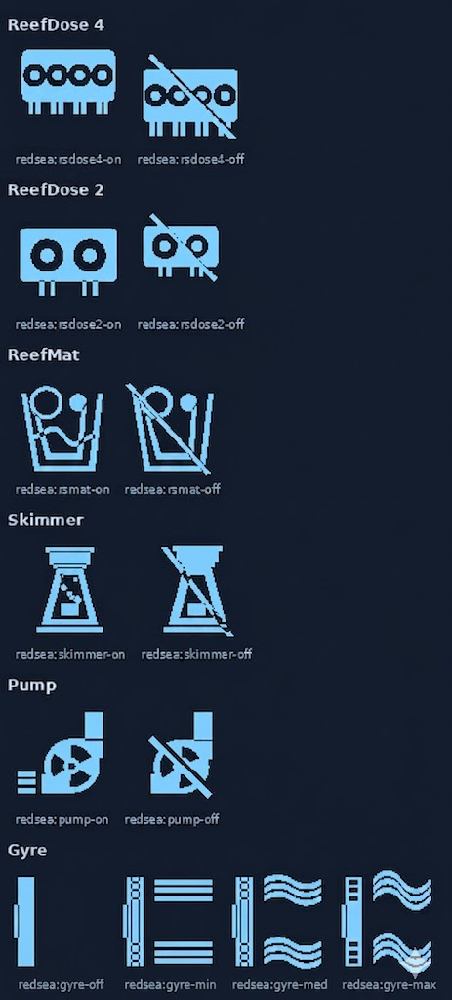

# UNRELEASED

## MODIFICATIONS

### Poseidon: what the app changes always reaches Home Assistant

Checked on every write command of the ReefBeat app in the spy runs (RSPOWER,
RSWAVE, RSDOSE, RSMAT, RSRUN, RSLED): each one is followed by a pushed
state, and what it changed comes back through it; the answers of the
commands carry nothing more. Two gaps closed:

- A read again by the poseidon strategy (state not fully merged, family
  without merger, dosing-log) now reads the config sources too: what the
  app changes is mostly settings (`/configuration`, `/device-settings`,
  `/acclimation`, `/moonphase`, `/preset_name/N`, `/auto/N`...), which the
  polling never reads again. A message arriving less than
  `PUSH_REFRESH_MIN_S` after a read is no longer dropped: one more read
  follows at the end of that delay.
- A merger now says "read again" whenever the state tells something it
  cannot write: a field it does not know, or the schedule of a ReefDose
  head (pushed without its intervals nor its time: an interval moved would
  have gone unnoticed). What it can merge is merged anyway. The ReefMat
  merges `auto_advance` and its `device_settings` into `/configuration`.
- Anomaly catalogue: the commands of a ReefDose head changed in the app
  (`validate-settings`, `PUT /head/N/settings`, `compensate/cancel`,
  `GET /bundle/settings`), `metrics.wifi_dis`, and a ReefWave telemetry
  without `active-wave` (pump off).

### Poseidon: ReefMat and ReefLED merged

- ReefMat (`reef-mat`), from a spy run with eleven advances (one manual):
  - state at each advance: `is_advancing`, `last_advance_cause`, the
    lengths (`today_usage`, `total_usage`, `remaining_length`) and the step
    counters into `/dashboard`. `/dashboard` truncates the lengths to 0.1
    (never rounds them up): so does the merger;
  - `rolling-log` (pushed at each advance) merged like a state: its
    `advance_cause` is the only message telling an advance by the EC sensor;
  - telemetry: mode, roll level, days left, lengths, step counters,
    material name, setup date (`+00:00` told as `Z`), wifi signal.
  - The EC readings of `/dashboard` are pushed by nothing: it keeps its
    polling (`reduced_minutes`).
- ReefLED (`reef-lights`) telemetry: the channels Home Assistant reads in
  `/manual` (only those it has: a G2 has others), the fan, the temperature,
  the moon phase, the acclimation, the active program, the mode and the
  wifi signal. No state seen yet.
- Checked by replaying the run: no difference on what is merged.
- Anomaly catalogue: the state a ReefControl Power pushes on connection
  (`attributes`, setup dates, feeding type, temperature settings, time
  zone) and `metrics.res` in the telemetry are known.

### Poseidon: devices protected when they join the relay

- Guard of a new connection (option `connect_guard`, on by default): for
  the first 30 seconds of each connection of a device to the relay, the
  write commands of the Red Sea cloud (`POST`, `PUT`, `DELETE`, and the
  commands that cannot be read) are not forwarded; its reads still are. At
  a first connection through the relay, the cloud may restore an old copy
  of the device settings: a ReefWave lost its whole schedule that way, 3 s
  after connecting (`/auto/init`, `/auto` with a single "No Wave",
  `/auto/complete`). The cloud does it at every connection (a ReefDose gets
  `POST /food-head`, its feeding schedule reset to default; a ReefWave
  `POST /group`, `/auto/init`, `/auto` per interval, `/auto/complete`,
  `/auto/apply`): these known restores are held back silently, only logged;
  any other write command held back raises a repair issue listing it. The
  spy and debug logs mark them all (`guard_blocked`, with `known_restore`
  and the command it would have written, keys masked).
- A device pointed at the relay that never connects to it (it kept its
  session with the Red Sea broker: an RSRUN did, while telling `CONNECTED`
  to the relay) is made to reconnect after 2 minutes: pointed back at the
  Red Sea broker, then at the relay again, twice at most. The spy log
  marks it (`reconnect`).

### Poseidon: ReefDose states and telemetry merged

- Mergers for the ReefDose (`reef-dosing`), written from a spy run of two
  RSDOSE4 3.0.1 with the HTTP answers:
  - telemetry (every 60 s): main mode, and per head the volumes dosed today
    (rounded to 0.1 mL as the device answers them), doses, daily doses,
    remaining days, stock level, recalibration, missed doses into
    `/dashboard`, container volume and today's volume into
    `/head/N/settings`, the wifi signal into `/wifi`. Checked against every
    poll of the run;
  - state: mode, battery, time error, device settings, and per head its
    state, daily dose, supplement, calibration and options. A pushed
    schedule other than the polled one is not merged: it only carries part
    of the schedule and the dosing queue follows it, so the device is read
    again.
- `/dosing-queue` is pushed by nothing, but every dose pushes a
  `dosing-log`: with the poseidon strategy, it reads the device again (at
  most once every `PUSH_REFRESH_MIN_S`), so the queue and the dosed volumes
  follow at once. A ReefDose keeps `reduced_minutes` otherwise.
- Anomaly catalogue of the ReefDose (no anomaly on the recorded runs).
  `rolling-log` (pushed by a ReefMat when its roll advances) and
  `dosing-log` are known topics.
- Telemetry catalogues of the ReefMat, ReefLED and ReefWave (their states
  and commands are not checked yet).
- `group/<family>/<group uid>` topics (ReefWave pumps synced together) are
  known: their messages are sent in clear (base64 of a JSON object padded
  with NUL bytes), decoded in the spy and debug logs and checked
  (`POST /group/sync` known).

### Poseidon: unexpected messages reported

- Every message crossing the relay for a device in Poseidon mode is checked
  against what is known of its family (`poseidon/anomalies.py`), on four
  levels:
  1. unknown MQTT packet type or topic (any family);
  2. unknown command sent to the device (method and URL, numbers as `*`);
  3. state with an unknown field, or a known field with another type;
  4. telemetry with an unknown field, a missing one or another type.
  Only the ReefControl Power has a catalogue yet (levels 2 to 4); it gives
  no anomaly on the recorded runs. `GET /time` and `POST /time` (sent by the
  ReefBeat app when its daylight saving setting changes) are known for every
  device.
- Each anomaly has a signature (hash of its kind, family, topic and key
  differences, never of the values): the same for every user. Its first
  occurrence goes to `logs/anomalies.jsonl` with an anonymised sample
  (hwid, names, network addresses, keys and secrets removed); the next ones
  are counted.
- An unknown command first waits 5 s for what the device made of it: its
  answer (`command-response` of the same `uuid`) and the states it pushed
  meanwhile (at most 5 messages, anonymised) go with it, in the log and in
  the prefilled issue.
- The signature is looked for in the titles of the GitHub issues (only the
  signature is sent, answer kept 24 h), and a repair issue tells what to do:
  open a new issue (link with title, body and label prefilled, sent only by
  the user), follow the open one, update to the version of its
  `fixed-in-x.y.z` label, or read the closed one. A telemetry anomaly only
  gets a repair when the search answered and found nothing.
- Two new options in the Poseidon settings: `anomalies` (detection, on by
  default; off removes its repairs) and `anomaly_search` (GitHub search,
  on by default).

### Poseidon: ReefControl Power states merged

- First merger of pushed states (`poseidon/mergers.py`), for the
  ReefControl Power (`reef-power`), written from a spy run with the HTTP
  answers. With the shadow and poseidon strategies, a socket switched, set
  or renamed, a schedule written or the strip turned off or on in the
  ReefBeat app shows in Home Assistant at once, without waiting for a poll:
  - `mode` -> `/mode` and `/dashboard` (`previous_mode` takes the old one);
  - `sockets.N` -> the socket `N` of `/dashboard` and `/sockets/config`
    (`prev_mode` takes the old mode); its `state` is not merged when the
    push says `unknown` (it always does, where `/dashboard` tells
    `standby` or `on`);
  - `schedule.N` -> `/socket/N/config/schedule`;
  - `feed_schedule`: nothing polled matches it yet, not merged.
- Telemetry merged too (every 60 s): main mode, battery level, and the
  consumption, mode and previous mode of each socket into `/dashboard`
  (mode also into `/sockets/config`), the wifi signal into `/wifi`. The
  consumption may lag a poll by up to a minute after a change (the device
  does not always push a telemetry at once). With the spy and shadow
  strategies, only the last telemetry waits for its comparison.
- Socket state computed as the ReefBeat app does (it never reads
  `/dashboard`): a socket in `schedule` mode is `on` within one of its
  intervals, `standby` otherwise, any other mode `unknown`, on the clock of
  the device itself (`local_time` of its telemetry, its own offset).
  Checked against every polled `/dashboard` of a spy run. Only with the
  strip in `auto` mode and for sockets driven by nothing else (no power
  detector, no sensor): the others keep their polled state.
- Poseidon strategy: a device whose pushed messages cover every value that
  changes (a ReefControl Power without temperature probe nor sensor driven
  socket) is only polled every `safety_minutes` (new option, 60 by
  default, never more often than `reduced_minutes`), as a safety net. The
  others keep `reduced_minutes`.
- `/cloud` of a device in Poseidon mode that is exchanging through the relay
  (traffic within the last 2 minutes) is read every `safety_minutes` only,
  instead of every minute: its traffic says where it is. As soon as it goes
  quiet (rebooting, pointed back at Red Sea), it is read every minute again.

### Poseidon spy: HTTP answers, pause, comparisons

- The spy file records the answer of each HTTP request sent to the device
  (`response`), to tell what a pushed value is in the polled sources. An
  answer equal to the previous one of the same request is not repeated
  (`response_unchanged`); a new spy run starts with whole answers. The
  answer of `/cloud` is never written (`response_omitted`: it holds the
  device keys), and keys, secrets, passwords and tokens are masked in the
  others. The answers are copied as the device sent them, before the
  integration adds to them.
- Fix: pausing the polling of a device let one more poll through (the one
  already scheduled); it is cancelled now.
- Fix: the comparisons of a pushed state found nothing: its values are
  wrapped in `specific_attributes`, absent from the polled sources. The
  wrapper is dropped; a value matched on a shorter part of its path tells
  it (`via`).
- Fix: the reads of `/cloud` Poseidon does through the coordinator were
  recorded with the `integration` origin; they are `poseidon` now
  (`http_origin` context of the API).

### Poseidon: new trident icon

- `redsea:trident` redrawn heavier: barbed outward tines, diamond
  spearhead, chevron guard and pommel (readable at 16-24 px).

### Fix: deprecated `DeviceEntry.config_entries`

- Poseidon no longer reads `DeviceEntry.config_entries` (deprecated since
  Home Assistant 2026.10, removed in 2027.10) but `config_entry_id`, with a
  fallback on the set for older Home Assistant versions.

### Cloud aquarium sensor

- New `aquarium` sensor (diagnostic) on every device linked to a cloud
  account: the name of the aquarium the device belongs to in the ReefBeat
  app, unknown when it is not linked or in no aquarium. Attributes:
  `aquarium_uid`, `cloud_account`, `system_model`, `water_volume`,
  `net_water_volume`. Not on LED groups. Refreshed when the device links to
  or unlinks from its account, and with the device's data; a rename in the
  app shows at the next device refresh.

### Messages: timestamp and history

- `last_message` and `last_alert_message` sensors: new `timestamp` attribute
  (ISO 8601, UTC) telling when the message / alert came; reset by
  `redsea.clean_message`.
- Every message and alert of a device is kept in a history
  (`.storage/redsea_messages_<entry_id>`), all of them, repeated ones
  included. Kept 31 days and at most 500 entries by default, both settable
  in the device settings (`message_history_days`, `message_history_max`).
  The history survives restarts and entry reloads, and is deleted with the
  entry.
- New `redsea.get_messages` service (response only): the history of a
  device, newest first, filtered by `msg_type`, `days` and `limit`. Used by
  ha-reef-card's message history dialog.
- Fix: a successful push no longer clears the last alert; only
  `redsea.clean_message` or a new alert replaces it.
- Fix: `redsea.clean_message` with `msg_type: All` now also clears the
  alert.

### RSDOSE: dose regulation of the heads

- New per-head `regulation_mode` select: `off`, `assisted` or `brine`.
- Bundled heads (Red Sea Complete Reef Care): only head 1 (Part 1) is
  regulated, in assisted mode on the calcium (Red Sea's weekly calcium
  test); the doser derives the other heads from the bundle ratios. The
  `daily_dose` of heads 2-4 is refused while the heads are bundled, as in
  ha-reef-card.
- Assisted dosing: set a target (KH, Ca, Mg, K, NO3, PO4), the supplement
  potency (unit/mL/100 L) and record test results (`regulation_measurement`
  + `regulation_record`, or the new `redsea.record_measurement` service).
  From the results and the volumes actually dosed, the tank's consumption is
  estimated and a new daily dose proposed (`regulation_proposed_dose`),
  applied only with `regulation_apply`. The correction is spread over a few
  days, capped per day, and a dose moves at most `regulation_max_change` %
  at a time. A result far from the prediction asks for a retest.
- Brine: new supplement "DIY - Brine" in the supplement list, the only one
  offering the salinity regulation (`regulation_mode`: off / brine on a brine
  head, off / assisted on any other); taking the brine off a head stops its
  regulation. The head holds a brine (g/L); a salinity sensor (RSCONTROL EC probe
  or any sensor in ppt, mS/cm or SG) is sampled every 10 minutes and Home
  Assistant sends manual doses (1 mL minimum) to hold the target salinity
  (default 35 ppt): learned salt loss plus a correction, capped per day
  (halved without a refractometer check for 45 days). Nothing is dosed while
  Home Assistant is down. Switching a head to brine mode switches its own
  schedule off: the whole plan is dosed by Home Assistant (a schedule the
  user switches back on is taken into account).
- Brine start: the salinity is sampled as soon as the brine mode and the
  sensor are set, and the regulation starts after 6 samples (1 hour); until
  then the status is `waiting_data` with `samples` / `samples_needed`, and
  `brine_salinity` shows the current reading (`averaged` attribute false)
  instead of nothing.
- A supplement changed on a head (brine put on or taken off) is seen on the
  next read of the doser: the regulation mode offers the right modes and
  the status follows at once (until then, until the next change of the
  regulation or a restart).
- Alarms (`regulation_alarm` binary sensor and `redsea_dose_regulation_alarm`
  event): too salty for 24 h, salinity not recovered after 3 days, sensor
  lost for 2 h, probe recalibration required.
- Refractometer check: a salinity recorded in brine mode is compared with
  the probe; within `salinity_check_tolerance` it marks the new RSCONTROL
  maintenance task `control_probe_refractometer_check` (monthly) done,
  otherwise the regulation pauses until the EC probe is calibrated again.
- Tank volume: the user's value, else the `water_volume` sensor of the
  reeftank aquarium holding the doser (the doser or a head placed on its
  views, or linked to the doser's cloud aquarium; reeftank stays optional),
  else the net water volume of the ReefBeat cloud aquarium of the doser.
- Brine concentration defaults to 200 g/L.
- Dosed volumes come from the doser's `/daily-log` (7 days, new config
  source), kept 180 days in `.storage/redsea_dose_regulation_<entry_id>`.

### Cloud aquariums for the aquarium view

- New WebSocket command `redsea/aquariums`: the aquariums of every ReefBeat
  cloud account (name, model, series, dimensions in cm, volumes) with the
  Home Assistant devices that belong to them and their feeding shortcut
  switches. The aquarium view of ha-reef-card (with the reeftank
  integration) uses it to pre-fill a new aquarium and filter its device
  tree.
- `websocket_api` added to the manifest dependencies.

### RSWAVE

- The `wave_type` sensor carries the whole day program in a `schedule`
  attribute (the intervals of `/auto`, an empty list when unknown), so
  ha-reef-card draws the day without its own request.
- Wave library and day program services, for the card's editors:
  - `redsea.wave_library`: waves of the pump's aquarium (cloud library) with
    its own intensities, the loaded pumps using each wave, the pump's group;
    without a cloud account, the waves of its own program;
  - `redsea.wave_library_save`: create (POST `/reef-wave/library`) or update
    (PUT `/reef-wave/library/<uid>`) a wave; the shape is shared, the
    intensities are the pump's (a new wave gives them to the whole group);
    the programs using an updated wave are posted again; Red Sea waves and
    taken names are refused;
  - `redsea.wave_library_delete`: DELETE `/reef-wave/library/<uid>`, refused
    for a Red Sea wave or a wave a loaded pump's program uses;
  - `redsea.wave_program_save`: POST `/reef-wave/schedule/<hwid>` for each
    pump of the group (same slots, each pump's intensities), or the local
    `/auto` handshake without a cloud account.
- A ReefWave group (grouped ReefWaves of the aquarium, cloud device list)
  refuses a write when one of its pumps is not loaded or not answering, as
  the ReefBeat app does (`wave_group_member_unavailable`); all refusals are
  translated Home Assistant errors.
- `redsea.wave_preview` / `redsea.wave_preview_stop`: run a wave on the pump
  for 1 to 10 min (local `/preview`), then back to its program.
- `redsea.wave_pump_set`: this pump's direction and intensities in the
  current wave, as the app lets each pump of a group run it its own way:
  its pump_settings of the wave (even a Red Sea one, shape untouched) and the
  direction of its current slot; the other pumps are left as they are.
- ReefWave groups, as in the ReefBeat app (all the grouped ReefWaves of an
  aquarium form one group, cloud only):
  - new switch `wave_grouped`: POST `/device/<hwid>/group` or `/ungroup`; a
    pump joining goes last (POST `/device/manage`); unavailable without a
    cloud account;
  - `redsea.wave_group_order`: order of the pumps of the group (POST
    `/device/manage`, `group_index`), every pump listed once;
  - `redsea.wave_group_set` (`grouped`: true / false): group or ungroup a
    pump, as the switch, for the card's program editor; `redsea.wave_library`
    also answers `grouped` (None without a cloud account);
  - every loaded ReefWave is refreshed after a change of group.
- New `linked_waves` sensor: number of pumps in the ReefWave group, with the
  list in its `waves` attribute (hwid, name, model, entry_id, available).
- New `redsea:wave-uniform`, `wave-random`, `wave-regular`, `wave-step`,
  `wave-surface` and `wave-none` icons: the wave type pictograms of the app.

### VIRTUAL LED (groups)
 - `linked_leds` sensor: each lamp of the `leds` attribute also gives its
   sunrise `offset` (minutes, staggered sunrise; None for a lamp without
   `/offset`), shown by the card under the lamp's name.
 - A virtual LED is now a group, as the "grouped" LEDs of the ReefBeat app:
   a shared value set on one of its lamps (manual channels, kelvin /
   intensity, mode, timer, programs, acclimation, moon phase) is applied to
   every lamp of the group. Per-lamp settings (name, Wi-Fi, cloud,
   firmware, identify, reset...) stay on the lamp.
 - A group write is refused when a lamp of the group is not loaded or does
   not answer (translated error naming the lamps): nothing is sent, the
   lamps stay in sync, as the app does.
 - White/blue cannot be set on a group holding a G2 lamp (translated
   error): use kelvin / intensity.
 - Members are kept as an ordered list of config entries
   (`members`); the order is the group order of the app (staggered
   sunrise, coming next). Options flow: choose the LEDs (a LED belongs to
   one group at most), then their order.
 - Config entry 1.2: the legacy `linked` mapping is migrated.
 - Members announce themselves on load/unload (dispatcher signals): a lamp
   reloaded on its own is no longer driven through a stale coordinator.
 - Staggered sunrise, as the app: switch `staggered_sunrise` and number
   `staggered_delay` (1-15 min, 10 by default) on the virtual LED; each lamp
   starts its day `delay x position` minutes later (`POST /offset`, which
   replaces the value). Written again when the members or their order
   change, once all the lamps are there; a lamp leaving the group gets 0.
   Kept in a per-group store (`redsea.group.<entry_id>`).
 - New number `sunrise_offset` (minutes) on each ReefLED answering
   `/offset` (probed at startup).
 - Weather program: the lamps of a group share the group's one. Turned on
   or set on any lamp of the group, it is on and set for all of them, and
   each lamp gets its own weather week; the nightly run is done once, by
   the group.
 - What blocks a group write, as the app: a lamp not loaded, not answering,
   or in a mode the group cannot drive (off, or held by a shortcut); a lamp
   out of service in the app is left out of the writes, the checks and the
   staggered sunrise.
 - Round trip with the ReefBeat cloud (lamps of one model, one aquarium,
   one account): the group, its order and its staggered sunrise are written
   (`POST /device/manage`, `PUT /aquarium/<uid>/group/<model>`, the offsets
   by `PUT /device/<hwid>`) or taken from the app, whichever changed since
   they were last in sync; both changed is a conflict.
 - Repairs: no cloud account for a group the app could hold (add it, or
   keep the group local); a group of several models whose lamps are still
   grouped in the app (ungroup them there); a conflict (keep Home
   Assistant's group or the app's).
 - Each lamp of a group has the `linked_leds` sensor too (its group's lamps,
   in order), for the card.
 - A new virtual LED starts with the lamps the ReefBeat app groups (options
   flow, in the app's order); at its first synchronization the app's order
   and staggered sunrise are taken. The cloud group of a model is named in
   lower case, as the app does ("rsled160").
 - Discovered devices: a group of the ReefBeat app (at least two lamps
   loaded in Home Assistant, one model, one aquarium) that no virtual LED
   drives is proposed as a new virtual LED (integration discovery, shown
   in "Discovered"), with its lamps in the app's order. Proposed again if
   its virtual LED is deleted; "Ignore" keeps it ignored.

### REEFLED acclimation and moon phase
 - Changing the acclimation duration or start intensity, or the moon day,
   now reads `/acclimation` (or `/moonphase`) back from the lamp, on each
   lamp of a group: these are "config" sources, a plain refresh left the
   sensors (remaining days, current factor, moon day...) as they were and
   took the number back to its former value.
 - Optimistic: turning the acclimation or the moon phase on or off, or
   changing their settings, shows at once what the lamp makes of it
   (acclimation: days left = duration, current factor = start factor, or
   stopped; moon: today's moon day, its intensity, days to the full and new
   moon), on each lamp of a group; the lamp is then read back.
 - In a group, turning the acclimation or the moon phase off on one lamp
   (`DELETE`) now turns it off on every lamp of the group, as turning it on
   already did.

### REEFLED G1 colour and intensity
 - The colour temperature and intensity set on a G1 are kept as set while
   the lamp reports the white/blue levels they give. Derived back from
   these whole levels, the intensity drifted down by one each time the
   colour was changed with the intensity compensation on (50, 49, 48...),
   and the colour temperature moved (10000 K read back as 9960 K).

### REEFLED library: renaming a program
 - New service `redsea.led_library_rename` (`uid`, `name`): renames one of
   the user's programs in the cloud library, its curves kept, then every
   day of the week named after it on the lamp and on each lamp of its
   group (a G1 day with the app's stamp, a G2 one bare), paced, with the
   progress shown as for a week being written. A Red Sea program, or a
   name already used, is refused.

### REEFLED weather program in the ReefBeat library
 - The weather week is kept in the ReefBeat library as programs of the
   user, one per weekday ("GPS 1" Monday ... "GPS 7" Sunday), added once
   then updated each time the week is written to the lamps (every
   `refresh_days`, on a changed setting, or when the lamp lost it). Each
   day of the lamp is named after its program, as the app names library
   programs, so the app shows the lamp playing programs it knows. They are
   removed when the weather mode is turned off. A lamp linked to no cloud
   account only gets its week. The programs were named "Weather" and were
   not in the library; lamps holding them are written again once.

### REEFLED weather program kept on the lamp
 - A lamp in weather mode that no longer holds the weather week (reset,
   restarted from its own programs, programmed from the ReefBeat app: seen
   from the name of its programs) is written the week again, a minute
   after it is set up and at the nightly run. It was left playing its own
   program under a weather mode shown as on.

### REEFLED G2 manual levels
 - A G2 is now written its colour temperature, intensity and moon only
   (`POST /manual` and `/timer`), as the ReefBeat app does: its white and
   blue levels are computed by the lamp and read only. The whole `/manual`
   was sent back as read, white and blue included.

### REEFLED weather program
 - The requests written to a lamp are paced (2 s, `WRITE_DELAY_S`): a
   ReefLED answers late, or not at all, to a command sent too soon. The
   progress of a week being written is on `weather_program` (`writing`:
   `{done, total}` days).
 - Colours chosen by the user for the weather days (setting `colors`,
   `{weekday: [{at, k}]}`, `at` from the rise 0 to the set 1): they replace
   the colours of the lamp's own program (a G1 converts them with its own
   table).

### RSPOWER
 - Two maintenance tasks, the first ones of the power center: *Visual
   inspection* (1 month by default, 1 to 3 months) and *Remove dust and salt
   deposits* (3 months by default, 2 to 4 months). Red Sea publishes no
   upkeep schedule for it: they follow general reef-keeping practice.
 - Calibration against a reference temperature (number
   `temperature_calibration`) replaces the `temperature_offset` number, as
   on the RSCONTROL probes (see there). `temperature_offset` is purged from
   the registry.
 - Optimistic updates for installing or removing the local temperature
   probe and unpairing the hub (see RSCONTROL).
 - `power_temperature` carries `ranges` (`[acceptable_low, desired_low,
   desired_high, acceptable_high]`, from `/temperature/config`) and `level`
   (from `/dashboard.temperature.level`), as the hub probes do, so a card
   draws its level the same way.

### RSCONTROL
 - New service `redsea.probe_calibration` to calibrate a pH or EC probe
   point by point, one step per call, as the ReefBeat app drives the hub
   (from its code, not captured yet): `enter`
   (`POST /probe/calibration-enter {"time"}`), `point`
   (`POST /probe/calibration-point-start {"point": LOW|MID|HIGH,
   "solution_value", "solution_rated_temp"}`, the temperature for pH only),
   `status` (`GET /probe/calibration-status`, returned to poll:
   `calibration_status`, `time_left`, `stability_progress`) and `exit`
   (`POST /probe/calibration-exit`, then the hub is read back). Addressed by
   config entry like `redsea.request`.
 - Calibration of the embedded temperature of pH, EC and ATO probes
   (number `probe_temp_calibration`, °C), the same way: it goes through
   `/probe/offset?type=<ph|ec|ato>&uid=…`, captured on pH and EC (adds too,
   and moves `temp_value`). Its date is not the probe's calibration date.
 - Calibration against a reference value replaces the offset numbers:
   `probe_orp_calibration` (mV) and `probe_temperature_calibration` (°C) per
   probe show its reading; with the probe in a solution or water of known
   value, setting the number to that value reads the probe again and moves
   its offset by `reference - reading`, as the ReefBeat app's ORP validation
   does, so the probe then reads the reference. The `probe_offset` numbers
   are removed, and purged from the registry.
 - `/probe/config` is read again when a probe appears or its
   `last_installation_date` changes. Reinstalling a probe resets its settings
   on the hub (an ORP probe goes back to `[100, 200, 400, 480]`); installed
   from the ReefBeat app, the integration kept the old ranges while the hub
   judged the level against the new ones (a card's bar and dot disagreed).
 - ORP probes get the date of their last validation (sensor
   `probe_last_adjustment`), read from `GET /probe/offset?type=orp&uid=…`
   (`{"offset", "last_adjustment_date"}`).
 - `POST /probe/offset` *adds* the posted value to the current offset
   (captured on an ORP probe: 1 + 35 = 36, 36 + 20 = 56, 56 - 55 = 1) and
   the readings include it. Every offset write posts the correction only,
   reads the offset back, and posts the full offset if a hub replaced it
   instead (not captured yet for a temperature probe).
 - Calibration reminders are dated by the hub: a pH or EC probe calibrated
   from the ReefBeat app (`/dashboard.probes[].last_adjustment_date`) or an
   ORP probe validated (`/probe/offset` `last_adjustment_date`) marks its
   calibration task done at that date. The task only moves forward, so a
   later press of its button is kept.
 - Probe calibration reminders follow Red Sea's official intervals: pH every
   3 months (was monthly; its interval is now set in months, number
   `maint_control_probe_calibration_ph_interval_months` replaces
   `..._interval_weeks`), ORP every 6 months (was 2) and a new salinity (EC)
   calibration task every 2 months (button, interval and notification switch
   per EC probe). Temperature probes still get no calibration reminder.
   Only the defaults change: an interval already set by the user is kept,
   so a pH or ORP interval chosen under the old ranges should be set again.
 - ATO module (the Red Sea ATO kit: a pump on a 12V port and an ATO probe),
   from a capture of the app installing it and its code. The per-port ATO
   entities built so far read RSATO+ fields and are replaced: a port holding
   the kit is of type `ato`, and its `/dashboard.ports` entry carries
   `auto_fill`, `today_volume`, `volume_left`, `is_pump_on`,
   `last_pump_on_cause` and `uid`, its `mode` reporting the module's faults
   (`missing_pump`, `stalled`, `empty`, `timeout`, `leak`,
   `port_malfunction`, as the app's `ControlPort.getAtoError` reads them).
   - New options-flow step **Install the ATO module** (once an ATO probe is
     installed and a port is free), following the app's wizard:
     `POST /port/<n>/install {"uid", "type": "ato"}`,
     `POST /ato/update-volume {"volume"}`, `PUT /ato/configuration
     {"volume_left", "port_index", "hose": {"length", "height"}, "auto_fill",
     "notify", "rvm_enabled"}`, then `PUT /ports/config` naming the port
     `ATO Module` and handing it the hub's button.
   - `/ato/configuration` is polled (as a config source) only while a module
     is installed; its `PUT` answers the whole configuration, which replaces
     the cached one at once.
   - Entities of the module's port: sensors `port_N_ato_status` (`ok` or the
     fault), `port_N_today_volume`, `port_N_volume_left`,
     `port_N_last_pump_on_cause`; binary sensors `port_N_is_pump_on`,
     `port_N_ato_fault`; switches `port_N_ato_auto_fill`,
     `port_N_ato_volume_monitor` (`rvm_enabled`), `port_N_ato_notify`,
     `port_N_ato_temp_log`; numbers `port_N_ato_volume_left`
     (`POST /ato/update-volume`), `port_N_ato_hose_length` /
     `port_N_ato_hose_height` (cm), `port_N_ato_flow_rate` (pump flow rate
     override, `pump_override.flow_rate_override` in mL, 0.2 to 4 L/min as in
     the app, 0 back to default: `-1`); buttons `port_N_ato_resume`
     (`POST /ato/resume`, available only during a fault),
     `port_N_ato_manual_pump` and `port_N_ato_stop` (from the app's code).
   - The `port_N_state` of the module's port follows its pump (`on` /
     `standby`): the hub reports no `state` for it.
   - Uninstalling the module's port removes its entities (from the
     registry, at once): from Home Assistant, the card or the ReefBeat app
     (seen on the next poll), or while Home Assistant was stopped (at
     setup). A module installed outside the options flow reloads the entry
     so its entities are built.
   - An ATO probe added from Home Assistant is named `ATO Temp. <uid>`, as
     the app does (`Temp. osmolateur 24E` in French).
 - Leak probes tell where the water comes from. `/dashboard` only has the
   boolean `detected`; the origin is in the probe's own reading
   (`GET /probe?type=leak&uid=…` → `leak_status`: `dry`,
   `aquarium_water_leak` or `rodi_water_leak`, and `ec`, the conductivity it
   measured), as the ReefBeat app models it (ControlLeakStatus). Each leak
   probe gets a `probe_leak_status` sensor (dry / aquarium water / RO/DI
   water) and a `probe_leak_conductivity` diagnostic sensor. A probe is read
   on its own as soon as it turns wet, once per leak; its "read value"
   button reads it too.
 - Fix: reading a leak probe on demand ignored a wet answer: only `dry`,
   `wet`, `leak` and `detected` were understood, not the firmware's
   `aquarium_water_leak` / `rodi_water_leak`.
 - Fix: a leak probe added from Home Assistant stayed in `status: setup` —
   not shown by the app, reporting nothing. Its install now follows the
   app's sequence: `POST /probe/install`, `GET /probe/info`, `POST
   /ble/off`, then `PUT /leak/config` (buzzer, leak detector, notification
   on, emergency shutdown off) and `PUT /probe/config` with its name
   (`Leak <uid digits>`, as the app names it). Every probe type now reads
   `/probe/info` after its install, as the app does.
 - Optimistic updates: an accepted write is shown at once, before the
   settle delay and read-back that follow it; the read-back corrects it if
   the device did not apply it. Covers the 12V ports as the card writes them
   through `redsea.request` (mode, name and power in `/ports/config`, probe
   rule in `/ports/subscribe`, install, uninstall), the port uninstall
   button, and pairing / unpairing the power center — both ends at once when
   the power center is set up too (pairing only when a single free power
   center makes it certain which one).
 - A failed GET no longer dumps the whole cached device data into the debug
   log: only the URL, status and reason are logged.
 - Fix: leak probe sensors were removed at every start-up ("Removing orphaned
   probe entity …_leak"). Their unique_id lacked the probe type
   (`probe_{uid}_detected`), so the orphan purge did not recognise them as
   belonging to a current probe. They are now keyed
   `probe_leak_{uid}_detected`; an existing entry is migrated before the
   platforms load, so the entity_id and its history are kept.
 - Every ReefSense probe entity (sensors and the leak `binary_sensor`) now
   carries `probe_uid`, `probe_type` and `probe_index` state attributes. All
   probes of a type share the same translation keys, so these attributes are
   the only way for a card to group a hub's entities per probe;
   `probe_index` is the probe's position in `/dashboard.probes`.
 - The measurement sensors (main value and embedded temperature) also carry a
   `ranges` attribute, `[acceptable_low, desired_low, desired_high,
   acceptable_high]`, read from `/probe/config` (`temp.ranges` for the
   temperature).
 - Every per-port entity of the 12V ports (sensors and ATO binary sensors)
   carries a `port` attribute (0-based), for the same reason.
 - Every entity of a 12V port (switch, name, ATO buttons and numbers
   included) now carries the `port` attribute, not only the sensors: both
   ports share their translation keys, so it is what tells a card which port
   an entity drives. The keys themselves are unchanged.
 - The `port_N_mode` sensor carries what a card needs to edit the port, as
   `socket_N_mode` does on a power center: `config` (the whole
   `/ports/config` entry, `power_on_percent` included), `schedule` and
   `sensor_config` (the hub's probe rule for the port, from the `internal`
   part of `/subscription-info`, else the `sensor` field of the port entry
   when it names a probe — the app's own `{default_state, app_cache}` there
   is not a rule),
   with `sensor_source: control`.
 - A port's schedule is read back from `GET /port/<n>/schedule`, only while
   the port is in `schedule` mode (from `/dashboard` on polls, from
   `/ports/config` after a config refresh): an uninstalled port answers 503
   and a port on, off or probe-driven does not use it. The source is
   registered when the port switches to schedule, fetched at once, and
   dropped when it leaves that mode.
 - The probe settings (range bounds, EC unit, temperature offset, buzzer /
   notify / enabled / maintenance switches, "read now" button) carry
   `probe_uid` and `probe_type` too, so a card can open the settings of one
   probe. They carry no `probe_index`: these attributes are set once at
   setup, and only the measurement sensors track the live position.

### RSATO
 - New `buzzer_enabled` switch on the RSATO+: enables/disables the leak alarm
   buzzer. Reverse-engineered from the Red Sea Android app
   (`ATODevice$Keys$Configuration$Buzzer`), pushed as
   `{"buzzer": {"enabled": <bool>}}` on a PUT to `/configuration`. The key is
   omitted from the payload when the device has not reported it, since the
   firmware merges partial configurations.
 - The switch replaces the read-only `binary_sensor.buzzer_enabled`, which
   reported the same firmware setting from `/dashboard`. **Breaking**: that
   entity is gone; use the switch, which now reads from `/dashboard` too and
   so keeps following changes made in the Red Sea app.
 - Same treatment for the leak probe's arming flag: the read-only
   `binary_sensor.enabled` becomes a switch (`leak.sensor_enabled` on
   `/configuration`, read back from `/dashboard.leak_sensor.enabled`).
   **Breaking**: the binary_sensor is gone, the switch keeps its
   `enabled` translation key and label.

### BUTTONS
 - Every generic button now reads the device back after its action, as the
   dose, run and wave button entities already did. **Fixes** the ATO fill and
   stop-fill buttons leaving `is_pump_on` stale until the next scan interval.
 - New `optimistic` field on `ReefBeatButtonEntityDescription`: values written
   into the cache as soon as the command is accepted, so entities move on the
   press instead of on the read-back a couple of seconds later. Used by the
   ATO fill and stop-fill buttons for `is_pump_on`; the refresh that follows
   replaces the guess with what the device reports.

### ALL DEVICES
 - New `fetch_data` button on every device, next to `fetch_config`. It forces
   an immediate read of the polled "data" sources instead of waiting for the
   scan interval, where `fetch_config` only covers sources typed "config".
   Offered whatever `live_config_update` is set to, since data sources are
   polled either way.

### RSATO polling
 - `/configuration` is now a polled "data" source instead of an on-demand
   "config" one. It carries `auto_fill`, which the device does not report on
   `/dashboard`, so the switch used to stay stale until someone pressed
   `fetch_config`. Costs one extra GET per cycle on the LAN; `fetch_config`
   no longer covers this source, since that button only refreshes sources
   typed "config".

### SWITCH
 - New `push_source` field on `ReefBeatSwitchEntityDescription`, for a setting
   read at one endpoint and written at another. Defaults to the source named
   in `value_name`, so every existing switch is unchanged.

### CONST
 - New `ATO_BUZZER_ENABLED_INTERNAL_NAME`.

### TRANSLATIONS
 - New `entity.switch.buzzer_enabled` key in the 8 locales and `strings.json`;
   `entity.binary_sensor.buzzer_enabled` removed with its entity.

## FIXES

### RSCONTROL probes
 - The probe-scoped maintenance tasks were built by `button.py` and
   `switch.py` as a single device-level entity, without the `{probe}`
   translation placeholder their names require, which HA reported as a
   name/placeholder mismatch. They now fan out per ReefSense probe through
   `iter_maintenance_probes()`, as `number.py` already did.

### ENUM sensors
 - An ENUM sensor whose device reported a value outside its `options` raised
   `ValueError` on every state write, killing the entity and every other
   listener of the same coordinator. Seen on `port_N_last_pump_on_cause`,
   which an RSCONTROLPRO ATO port reports as `unknown` -- a reserved HA state
   that can never be an option. Unlisted values are now reported as unknown.

# v2.3.0

## NEW DEVICES

Adds read-only support for the new ReefControl family:

 - **RSPOWER6 / RSPOWER8** — ReefControl Power smart center (6 or 8 AC sockets).
   Exposes per-socket name, mode, state and consumption, plus battery level,
   temperature and pairing status to the ReefControl hub.
 - **RSCONTROLPRO / RSCONTROLLITE** — ReefControl hub for ReefSense probes.
   Exposes per-port (12V DC) name, mode, state, type and consumption, plus
   cable-connected, leak-detector, buzzer status and pairing status to the
   ReefControl Power center. Pro has 2 ports, Lite has 1.

Write endpoints (per-socket on/off, mode change, probe calibration) are **not
yet reverse-engineered** — only monitoring is available at this stage. Sniffs
of real device traffic are welcome to unlock write support in a later release.

## MODIFICATIONS

### CONST
 - New `HW_POWER_IDS`, `HW_CONTROL_IDS`, `HW_POWER_SOCKET_COUNT`,
   `HW_CONTROL_PORT_COUNT`, `POWER_SCAN_INTERVAL`, `CONTROL_SCAN_INTERVAL`.
 - `HW_DEVICES_IDS` extended so LAN auto-detection picks up the new models.

### API
 - New `ReefPowerAPI` and `ReefControlAPI` classes (both register
   `/configuration` as a config source).

### COORDINATORS
 - New `ReefPowerCoordinator` (with `socket_count` derived from hw_model)
   and `ReefControlCoordinator` (with `port_count`: 1 for Lite, 2 for Pro).
 - `get_model_type()` maps to `reef-power` / `reef-control` for firmware URL
   resolution against the cloud.

### PLATFORMS
 - `sensor.py`: new `POWER_SENSORS` and `CONTROL_SENSORS` static descriptions,
   plus dynamic per-socket / per-port sensors.
 - `binary_sensor.py`: new `POWER_SENSORS` and `CONTROL_SENSORS` for internet,
   pairing, cable, buzzer, leak-detector and per-socket enabled flags.

### TRANSLATIONS
 - New keys in `en.json` and `fr.json` for the new sensors and binary sensors.

# v2.0.1

CLOUD: Correct #63 - Cant log to redsea account

# v2.0.0

> [!CAUTION]
>  CLOUD, RSDOSE and RSRUN users: you have do delete and recreate your devices.

## GENERAL

### Compatibility with the new ha-reef-card

Follow this link to install it:

### Big code refactoring thanks to @roblandry
Because the device id creation changed to be compliant with HA standards, RSDOSE and RSRUN users will see double sub-device with half empty. Remove your device and recreate it.

### New icons for your HomeAssistant

## MODIFICATIONS

### ALL
 - Use strandard HA translations method for all devices and entities.
 - Add check_translation utility
 - Add de, es, it ,pl and pt languge support.

### CLOUD
- Add schortcut support.
- Correct scan_interval.

### RSATO
- Remove ato_mode.

### RSDOSE
- Correct supplement is_name_editable for specific supplement
- Add support of supplement display_name modification
- Add size for supplements

### RSLED
- Remove death code.

### RSMAT
- Correct #60. Since firmware update schedule time is in seconds and not more in minutes.

### RSWAVE
- Correct load preview.

### Icons
 - Add personnal icons for redsea domain.

