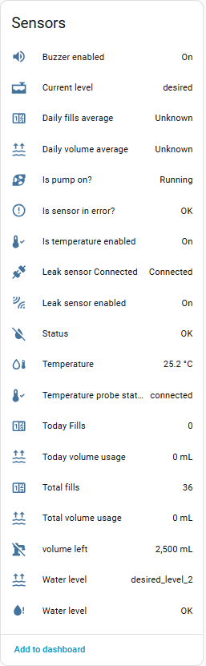
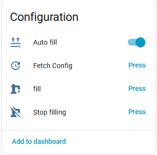
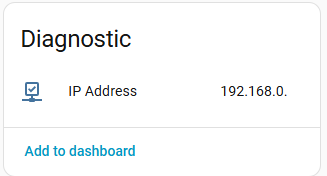

[← Volver a la página principal](README.es.md)

# ReefATO:
- Activar/desactivar el relleno automático
- Relleno manual
- Activar/desactivar el zumbador de alarma de fuga

> [!IMPORTANT]
> El [modo Poseidon](poseidon.es.md#estrategias) nunca ha funcionado en un ReefATO+: no tengo ninguno. Use primero la estrategia *Espía*, y luego envíeme sus registros o abra las reparaciones que genere, como se explica [aquí](poseidon.es.md#estrategias).

### Tareas de mantenimiento
| Tarea | Por defecto | Rango |
| ----- | ----------- | ----- |
| Limpiar la sonda EC | 6 semanas | 3 – 9 semanas |
| Limpiar la bomba de retorno | 4,5 meses | 2 – 7 meses |

Consulta la sección [Mantenimiento](maintenance.es.md#mantenimiento).

---

[← Volver a la página principal](README.es.md)
