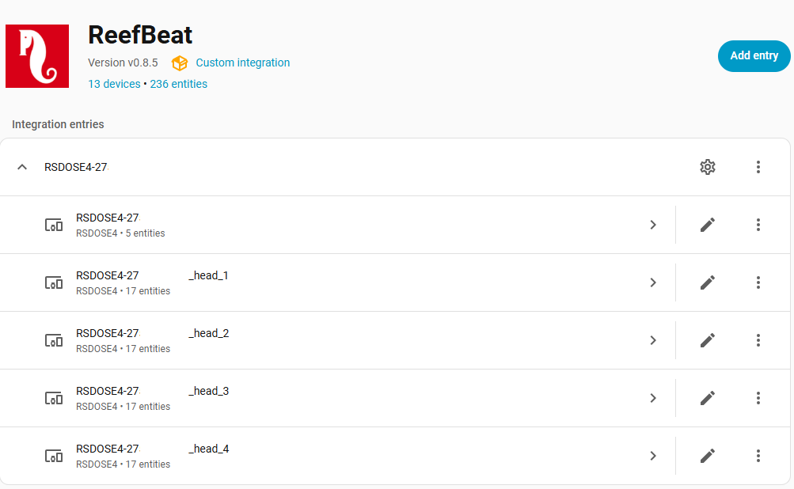
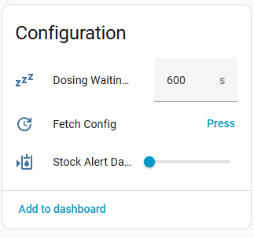
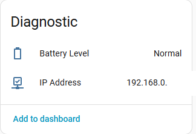
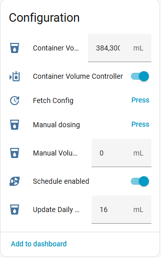
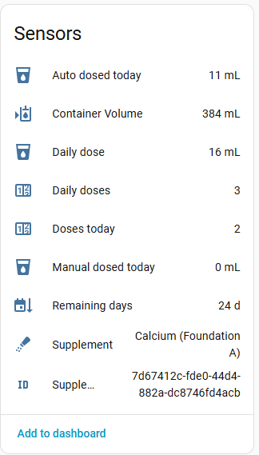
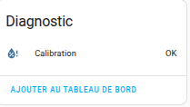
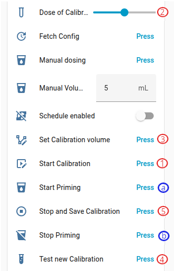

[← Powrót do strony głównej](README.pl.md)

# ReefDose:
- Edytuj dzienną dawkę
- Ręczne dozowanie
- Dodawaj i usuwaj suplementy
- Edytuj i kontroluj objętość pojemnika. Ustawienia objętości pojemnika są automatycznie włączane lub wyłączane zależnie od przełącznika kontroli objętości.
- Włącz/wyłącz harmonogram dla każdej pompy
- Konfiguracja alertów zapasów
- Opóźnienie dozowania między suplementami
- Napełnianie (Proszę przeczytać [to](#kalibracja-i-napełnianie))
- Kalibracja (Proszę przeczytać [to](#kalibracja-i-napełnianie))
- [Regulacja dozowania](#regulacja-dozowania): dozowanie wspomagane i solanka
- [Historia dawek](poseidon.pl.md#historia-dawek), w trybie Poseidon

### Główny

### Głowice

#### Kalibracja i napełnianie

> [!CAUTION]
> Musisz ściśle przestrzegać poniższej kolejności (Using the [ha-reef-card](https://github.com/Elwinmage/ha-reef-card) is safer).  
> <ins>Calibration</ins>:
>  1. Ustaw pojemnik z podziałką i naciśnij „Rozpocznij kalibrację"
>  2. Wpisz zmierzoną wartość w polu „Dawka kalibracyjna"
>  3. Press "Set Calibration Value"
>  4. Opróżnij pojemnik z podziałką i naciśnij „Testuj nową kalibrację". Jeśli uzyskana wartość nie wynosi 4 mL, wróć do kroku 1.
>  5. Press "Stop and Save Graduation"
>
> <ins>For priming</ins>:
>  1. (a) Press "Start Priming"
>  2. (b) Gdy płyn zacznie wypływać, naciśnij „Zatrzymaj napełnianie przewodów"
>  3. (1) Ustaw pojemnik z podziałką i naciśnij „Rozpocznij kalibrację"
>  4. (2) Wpisz zmierzoną wartość w polu „Dawka kalibracyjna"
>  5. (3) Press "Set Calibration Value"
>  6. (4) Opróżnij pojemnik z podziałką i naciśnij „Testuj nową kalibrację". Jeśli uzyskana wartość nie wynosi 4 mL, wróć do kroku 1.
>  7. (5) Press "Stop and Save Graduation"
>
> ⚠️ Po napełnieniu przewodów zawsze należy wykonać kalibrację (kroki 1 do 5)!⚠️

  

### Regulacja dozowania

Każda głowica ma wybór **Regulacja dozowania**: *Wyłączona*, *Dozowanie wspomagane* lub *Solanka (zasolenie)*. [ha-reef-card](https://github.com/Elwinmage/ha-reef-card/blob/main/doc/pl/reefdose.pl.md#regulacja-dozowania) zbiera jej encje w oknie konfiguracji głowicy.

Objętość wody pochodzi z **Objętość wody w zbiorniku**, jeśli ją ustawisz; w przeciwnym razie z akwarium [ReefTank](https://github.com/Elwinmage/ha-reeftank-component) dozownika; w przeciwnym razie z jego akwarium w chmurze ReefBeat. Sensor **Użyta objętość wody** pokazuje, która obowiązuje.

#### Dozowanie wspomagane

Ustawiasz cel (na przykład KH 8,4 dKH) i zapisujesz wyniki testów. Na podstawie wyników i objętości faktycznie dozowanych między nimi (`/daily-log` dozownika) integracja szacuje zużycie w akwarium i **proponuje** dawkę dzienną. Nic nie trafia do dozownika, dopóki jej nie zastosujesz.

1. Wybierz **Regulowany parametr** (KH, wapń, magnez, potas, azotany, fosforany, jod lub żelazo) i ustaw **Cel regulacji**.
2. Sprawdź **Moc suplementu**: o ile 1 mL podnosi parametr w 100 L, jak podano na butelce. Jest wstępnie wypełniona dla suplementów, których etykieta ją podaje.
3. Po każdym teście wpisz wartość w **Wynik testu** i naciśnij **Zapisz wynik testu** albo wywołaj `redsea.record_measurement` (przydatne dla testu z datą: `measured_at`).
4. Gdy **Stan regulacji** pokazuje *Zaproponowano nową dawkę*, sprawdź **Proponowana dawka dzienna** i naciśnij **Zastosuj proponowaną dawkę** lub **Odrzuć proponowaną dawkę**.

Propozycja to zużycie w akwarium plus korekta: odchylenie od celu rozłożone na dni z **Rozłożenie korekty**, bez korekty w granicach **Tolerancja regulacji**. Różni się od bieżącej dawki najwyżej o **Maks. zmiana dawki** (domyślnie 20 %), a zmiana poniżej 5 % nie jest proponowana. Test zbyt odległy od oczekiwań daje *Zalecany ponowny test* zamiast propozycji.

> [!NOTE]
> Przy głowicach zgrupowanych (Red Sea Complete Reef Care) regulować można tylko głowicę 1, w dozowaniu wspomaganym na wapń: dozownik wylicza z niej pozostałe głowice.

#### Solanka

Głowica zawiera solankę, sól rozpuszczoną w wodzie: suplement **DIY - Brine**, jedyny regulowany według zasolenia. Home Assistant co 10 minut odczytuje czujnik zasolenia (sondę EC ReefControl lub dowolny czujnik, wybór **Czujnik zasolenia**) i wysyła małe dawki ręczne, aby utrzymać jego średnią 24-godzinną na poziomie celu (domyślnie 35 ppt). Celowo używa dawek ręcznych zamiast harmonogramu głowicy: gdy Home Assistant nie działa, nic nie jest dozowane, a zasolenie tylko powoli spada.

| Ustawienie | Domyślnie | Zastosowanie |
| ---------- | --------- | ------------ |
| Cel regulacji | 35 ppt | Utrzymywane zasolenie |
| Stężenie solanki | 200 g/L | To, co przygotowano |
| Maks. wzrost zasolenia | 0,5 ppt/dzień | Najszybsza dozwolona korekta |
| Dawki solanki na dzień | 12 | Podział objętości dziennej |
| Tolerancja kontroli refraktometrem | 1 ppt | Dopuszczalna różnica między kontrolą a sondą |

**Planowana solanka na dzień** podaje planowaną objętość. Co miesiąc zapisuj odczyt z refraktometru jako wynik testu `salinity`: poza tolerancją regulacja zatrzymuje się, dopóki sonda nie zostanie ponownie skalibrowana. Bez kontroli przez 45 dni dozwolony wzrost dzienny jest o połowę mniejszy.

**Alarm regulacji** włącza się, a zdarzenie `redsea_dose_regulation_alarm` jest wysyłane, gdy zasolenie jest zbyt wysokie (solanka nie może go obniżyć), gdy nie można go przywrócić do celu, gdy czujnik zostanie utracony oraz gdy potrzebna jest ponowna kalibracja.

### Zadania konserwacyjne
| Zadanie | Poziom | Domyślnie | Zakres |
| ------- | ------ | --------- | ------ |
| Kalibracja głowic dozujących | Urządzenie | 90 dni | 80 – 120 dni |
| Wymiana głowic i wężyków | Na głowicę | 15 miesięcy | 11 – 19 miesięcy |

Wymiana śledzona jest **osobno dla każdej głowicy**: wymiana głowicy 2 nie
zeruje odliczania pozostałych trzech. Zobacz sekcję [Konserwacja](maintenance.pl.md#konserwacja).

---

[← Powrót do strony głównej](README.pl.md)
